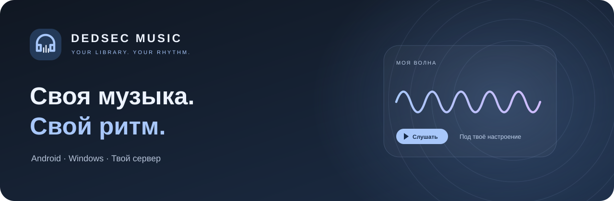
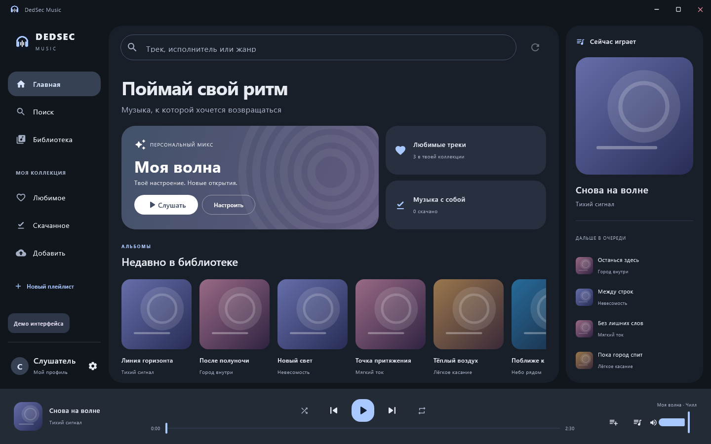
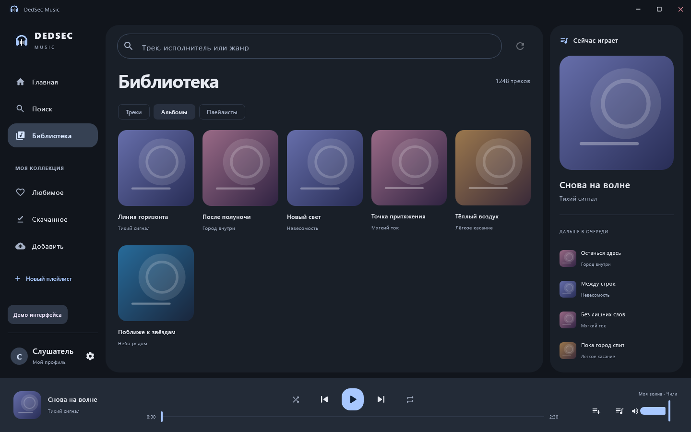
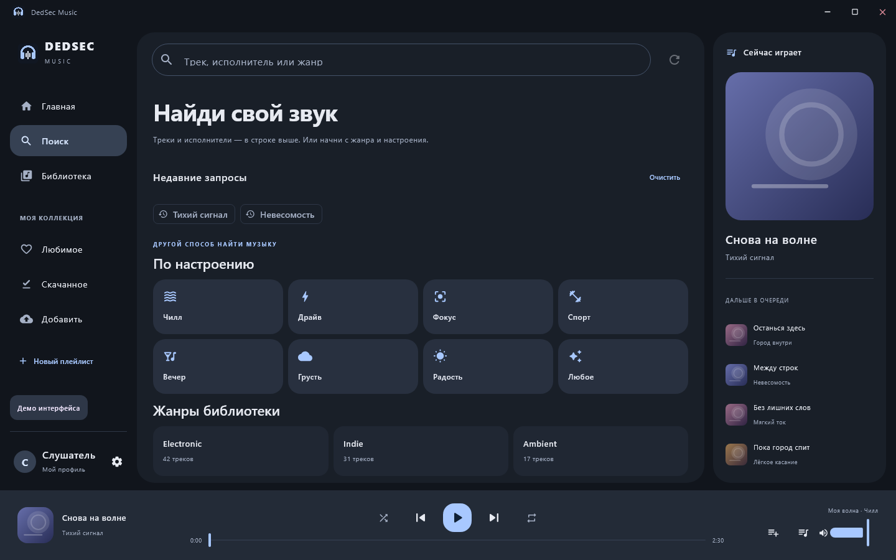
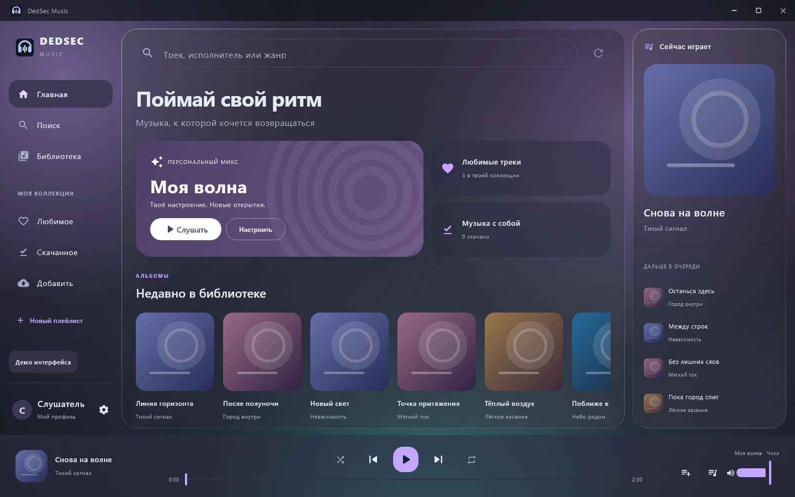
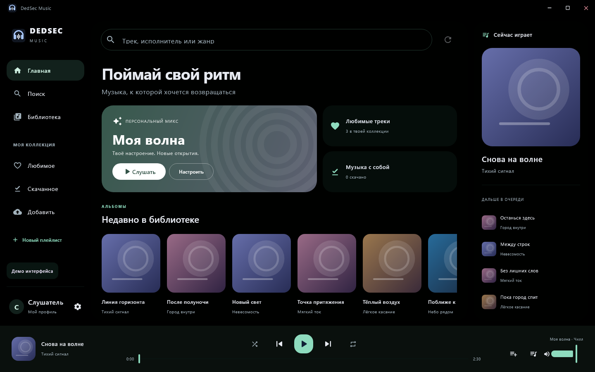
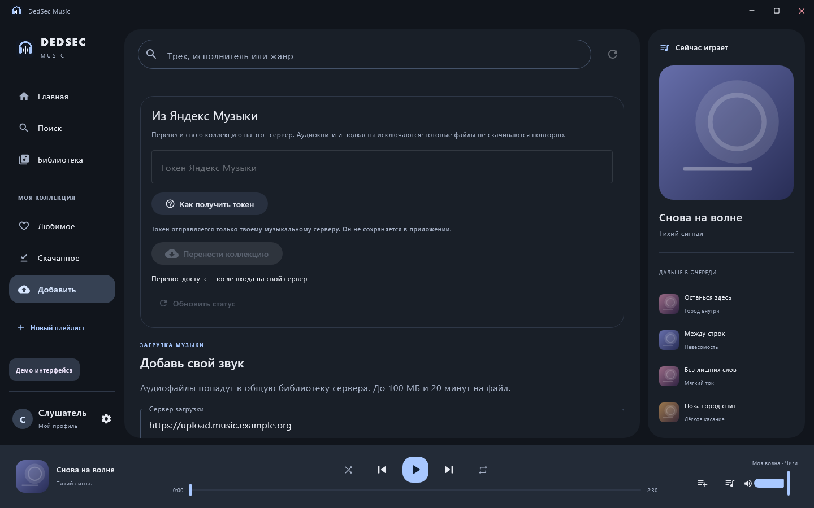

  

  
<strong>Музыка живёт на твоём сервере. Плейлисты, настроение и оформление — твои.</strong>

  

    
  

  

    
    
    
    
    
  

  
<a href="#интерфейс">Интерфейс</a> · <a href="docs/FEATURES.md">Возможности</a> · <a href="docs/BUILDING.md">Сборка</a> · <a href="server/README.md">Свой сервер</a> · <a href="docs/YANDEX_IMPORT.md">Перенос коллекции</a>

## Твоя библиотека на всех устройствах

DedSec Music — открытый музыкальный клиент для Android и Windows. Подключи Navidrome, собери любимую коллекцию и слушай её дома, в дороге и без интернета. На одном сервере можно жить с друзьями: аудиотека общая, а плейлисты и избранное у каждого свои.

[**Android и Windows →**](https://github.com/Dedseckms/Dedsec-Music/releases/latest) · [**iPhone Preview →**](https://github.com/Dedseckms/Dedsec-Music/releases/tag/ios-v0.1.0). iPhone устанавливается через [AltStore с Windows](docs/IPHONE.md); macOS — в [плане развития](docs/MULTIPLATFORM.md).

## Интерфейс

Горизонтальное окно на компьютере, Material 3, спокойные цвета и управление воспроизведением под рукой. На скриншотах — интерфейс Windows с демонстрационной библиотекой.

<table>
  <tr>
    <td width="50%"> <strong>Вся коллекция</strong> — треки, альбомы и личные плейлисты.</td>
    <td width="50%"> <strong>Открывай музыку</strong> — поиск, исполнители и жанры.</td>
  </tr>
  <tr>
    <td> <strong>Стекло</strong> — прозрачность, блики и глубина.</td>
    <td> <strong>AMOLED</strong> — чёрный фон и цветные акценты.</td>
  </tr>
</table>

## Что внутри

| | Возможности |
| :-- | :-- |
| **Слушать** | Потоковое воспроизведение, очередь, перемешивание, повтор и офлайн-копии. |
| **Находить** | Поиск по части названия, страницы исполнителей, альбомы и жанры из тегов библиотеки. |
| **Моя волна** | Персональный микс из музыки сервера: настроение, любимое, открытия и баланс. |
| **Собирать** | Личные плейлисты, избранное и аватар профиля. |
| **Добавлять** | Загрузка аудиофайлов и серверный перенос коллекции Яндекс Музыки с прогрессом. |
| **Оформлять** | Material, Стекло, Аврора, Минимал; палитры, светлая, тёмная и AMOLED-темы. |
| **В дороге** | Android MediaSession, фоновое воспроизведение и каталог для Android Auto. |
| **Обновлять** | Проверка GitHub при запуске; установка новой версии по подтверждению пользователя. |
| **Управлять** | Администратору — пользователи, создание аккаунтов, их загрузки и удаление с сохранением общей музыки. |

«Моя волна» использует жанры, историю, избранное, пропуски и фоновый анализ звука на сервере. Поддержка отдельных капсул и панелей оболочек Android зависит от прошивки телефона. Волна, управление пользователями, перенос, профили и проверка загрузок требуют серверного дополнения из этого репозитория.

## С чего начать

1. Есть Navidrome? [Скачай клиент](https://github.com/Dedseckms/Dedsec-Music/releases/latest) или [собери из исходников](docs/BUILDING.md), введи HTTPS-адрес сервера, логин и пароль.
2. Нужен весь комплект? Разверни [сервер с пошаговыми скриптами](server/README.md).
3. Хочешь забрать свою коллекцию? Во вкладке **«Добавить»** открой карточку **«Из Яндекс Музыки»**. [Где получить токен →](docs/YANDEX_IMPORT.md#получить-токен)

Администратор создаёт пользователей. Каждый входит в собственный аккаунт; доступные ему треки определяются библиотеками сервера. [Подробнее о возможностях и границах](docs/FEATURES.md).

В клиенте уже указан сервер проекта. Для своей установки замени адрес при входе; аккаунт для сервера проекта выдаёт его администратор.

<strong>Перенос коллекции и кнопка получения токена</strong>

Сбор коллекции, скачивание, проверка каталога и восстановление личных плейлистов отображаются отдельными этапами. [Открыть гайд →](docs/YANDEX_IMPORT.md)

## Для разработчиков

Kotlin · Jetpack Compose · Compose Desktop · Material 3 · Media3 · libVLC · Navidrome / OpenSubsonic.

Общий модуль протокола используется обоими клиентами. В репозитории находятся исходники приложений, серверное дополнение, инструменты сборки и оформление установщика Windows.

[Сборка и проверка](docs/BUILDING.md) · [Архитектура и платформы](docs/MULTIPLATFORM.md) · [Как устроены обновления](docs/UPDATES.md) · [Сообщить об ошибке](https://github.com/Dedseckms/Dedsec-Music/issues)

## Лицензия

**GPL-3.0-or-later.** Можно изучать, изменять и распространять проект с соблюдением условий [лицензии](LICENSE). Сведения о сторонних компонентах — в [THIRD_PARTY_NOTICES.md](THIRD_PARTY_NOTICES.md).
